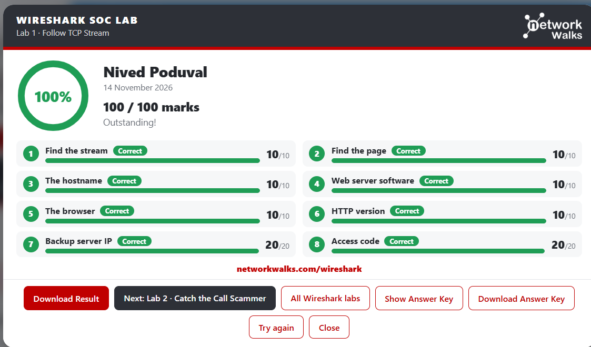
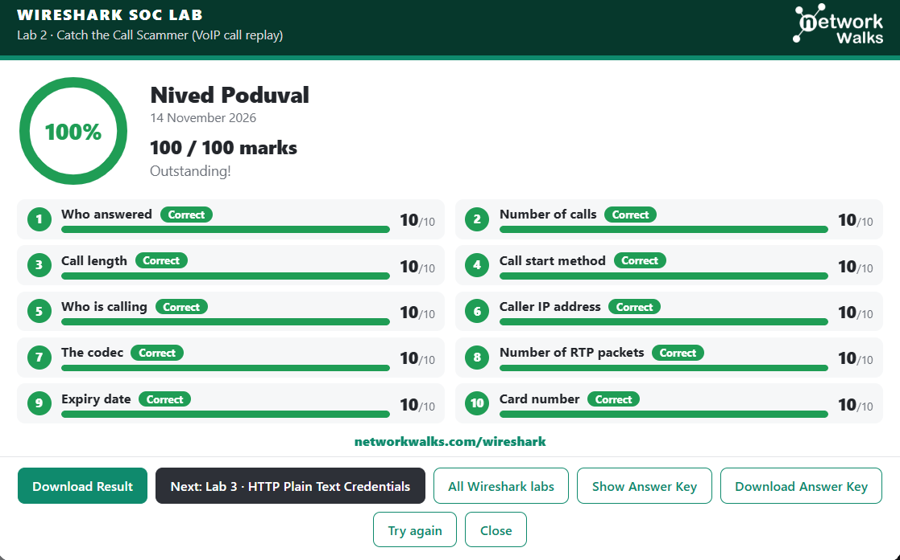
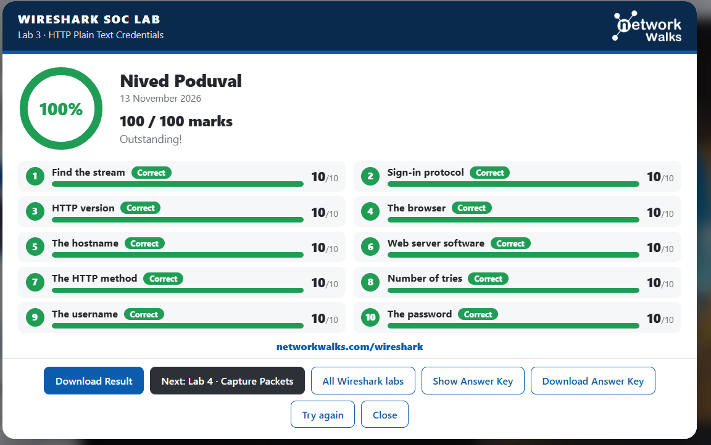
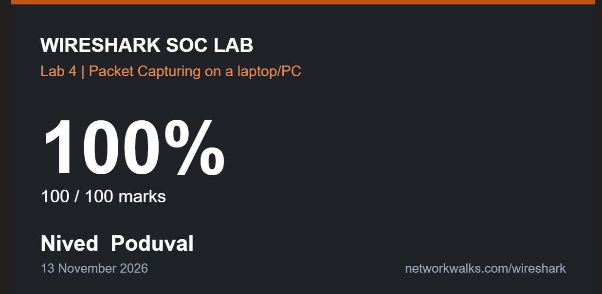
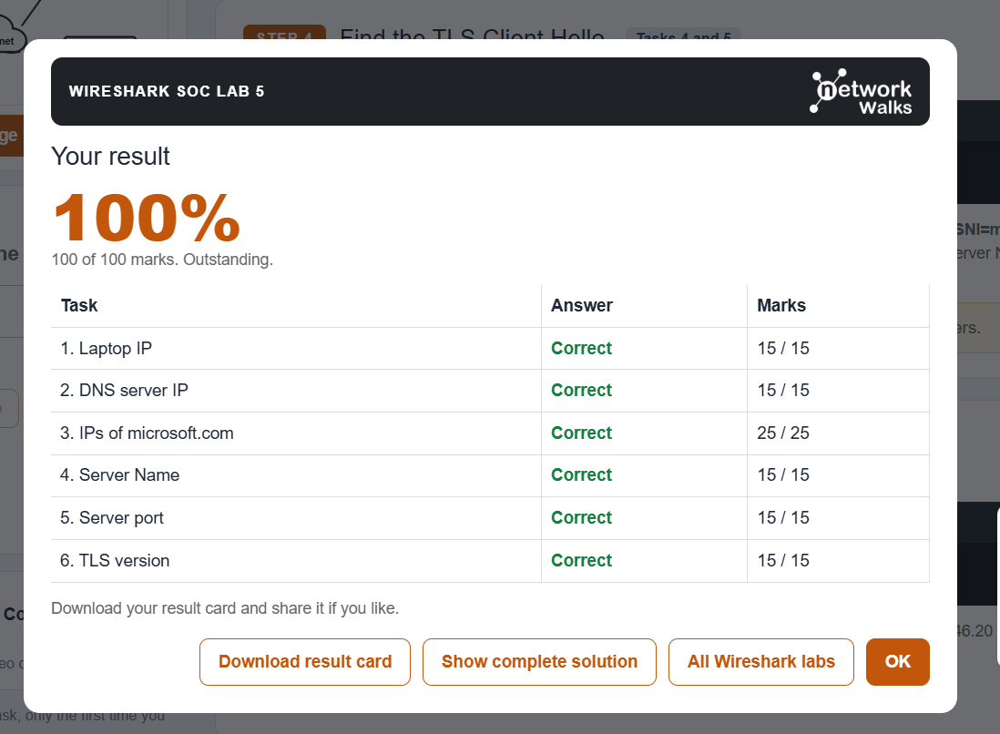

# 🦈 Wireshark Network Security Lab

  
  
  
  

---

## 📌 About This Project

This repository documents my hands-on practical exercises on network packet analysis and cybersecurity defense using Wireshark. Across five intensive labs, I captured and inspected live traffic, reconstructed unencrypted sessions, investigated VoIP fraud patterns, and analyzed TLS cryptographic handshakes.

---

## 🛠️ Tools & Technologies

| Tool / Technology | Purpose |
| :--- | :--- |
| **Wireshark** | Network packet capture, protocol dissection, and deep packet inspection |
| **Kali Linux** | Cybersecurity analysis, traffic generation, and security testing platform |
| **VirtualBox** | Isolated virtualization environment for safe network experimentation |

---

## 🔍 Wireshark Filters

Key display and capture filters utilized across the investigation scenarios:

| Filter / Syntax | Description | Lab Reference |
| :--- | :--- | :--- |
| `tcp.stream eq <id>` | Isolates and reconstructs a complete bidirectional TCP conversation | Lab 1 & Lab 3 |
| `sip \|\| rtp` | Filters VoIP Session Initiation Protocol signaling and RTP audio streams | Lab 2 |
| `sip.Method == "INVITE"` | Identifies VoIP call initiation attempts and caller/callee metadata | Lab 2 |
| `http.request.method == "POST"` | Detects HTTP form submissions exposing cleartext authentication credentials | Lab 3 |
| `ip.addr == <host_ip>` | Isolates network traffic associated with a specific host machine or interface | Lab 4 & Lab 5 |
| `dns.qry.name contains "<domain>"` | Filters DNS lookups to track target domain resolution and IP mappings | Lab 5 |
| `tls.handshake.type == 1` | Filters TLS Client Hello packets to inspect SNI and cipher negotiation | Lab 5 |

---

## 🧪 Completed Labs & Practical Analysis

### Lab 1 — Follow TCP Stream
- **Score:** `100% (100 / 100 marks)`
- **Key Analysis:** Reconstructed unencrypted TCP communication streams, extracted application-layer web server metadata, identified browser user agents, and retrieved hidden access codes.
- **Outcome:** Mastered TCP stream reassembly and understood the risks of unsegmented web protocols.

  

---

### Lab 2 — Catch the Call Scammer (VoIP Call Replay)
- **Score:** `100% (100 / 100 marks)`
- **Key Analysis:** Inspected malicious VoIP telephony traffic, analyzed SIP handshake methods, extracted caller IP and codec information (PCMU), and replayed RTP media packets to uncover intercepted credit card data.
- **Outcome:** Developed forensic capabilities in VoIP signaling reconstruction and real-time audio analysis.

  

---

### Lab 3 — HTTP Plain Text Credentials
- **Score:** `100% (100 / 100 marks)`
- **Key Analysis:** Filtered HTTP `POST` traffic targeting sensitive login endpoints, analyzed brute-force retry counts, and extracted exposed usernames and passwords transmitted without TLS encryption.
- **Outcome:** Demonstrated the critical security requirement of end-to-end transport layer encryption (HTTPS).

  

---

### Lab 4 — Packet Capturing on Laptop/PC
- **Score:** `100% (100 / 100 marks)`
- **Key Analysis:** Configured live packet capture on active network interfaces, applied capture filters versus display filters, and evaluated interface statistics in real time.
- **Outcome:** Gained fundamental competence in live host packet capture, adapter diagnostics, and local traffic baseline analysis.

  

---

### Lab 5 — TLS Client Hello & Encrypted Traffic Analysis
- **Score:** `100% (100 / 100 marks)`
- **Key Analysis:** Analyzed DNS queries and resolved destination servers for `microsoft.com`. Inspected the TLS 3-way handshake, isolated Client Hello packets, extracted Server Name Indication (SNI), and verified TLS protocol version negotiation.
- **Outcome:** Strengthened understanding of modern encrypted traffic analysis, TLS session establishment, and cipher suite discovery.

  

---

## 📊 Performance Summary

| Lab ID | Lab Name | Focus Area | Score | Status |
| :---: | :--- | :--- | :---: | :---: |
| **01** | Follow TCP Stream | Session Reassembly & Metadata | **100%** | Completed |
| **02** | Catch the Call Scammer | VoIP / SIP Signaling & RTP Forensics | **100%** | Completed |
| **03** | HTTP Plain Text Credentials | Cleartext Authentication Risks | **100%** | Completed |
| **04** | Packet Capturing on Laptop/PC | Interface Capture & Adapter Diagnostics | **100%** | Completed |
| **05** | TLS Client Hello Inspection | DNS Resolution & TLS Handshakes | **100%** | Completed |
| **Total** | **5 Hands-on SOC Labs** | **Comprehensive Packet Security** | **100%** | **Distinction** |

---

## 🎯 Key Takeaways

- **Deep Packet Inspection:** Gained proficiency in dissecting Layer 3, Layer 4, and Layer 7 protocol headers.
- **Security Forensics:** Extracted malicious indicators of compromise (IOCs), fraudulent telephony parameters, and leaked authentication credentials.
- **Cryptographic Visibility:** Analyzed the clear boundaries between insecure plaintext transmissions (HTTP) and secured TLS handshakes (SNI inspection).
